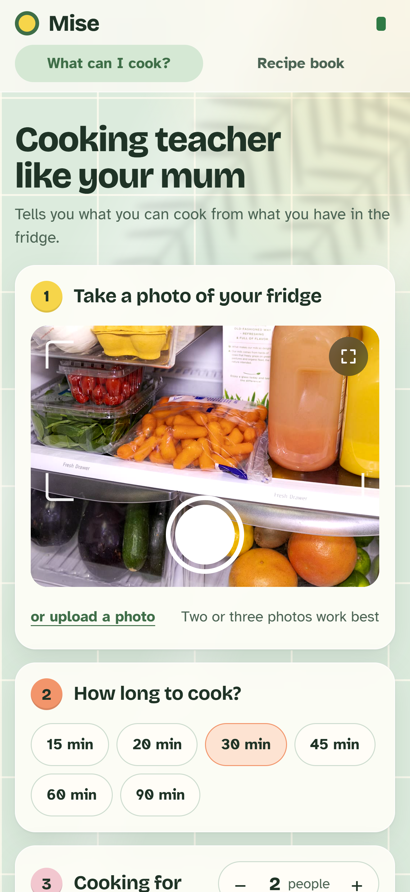
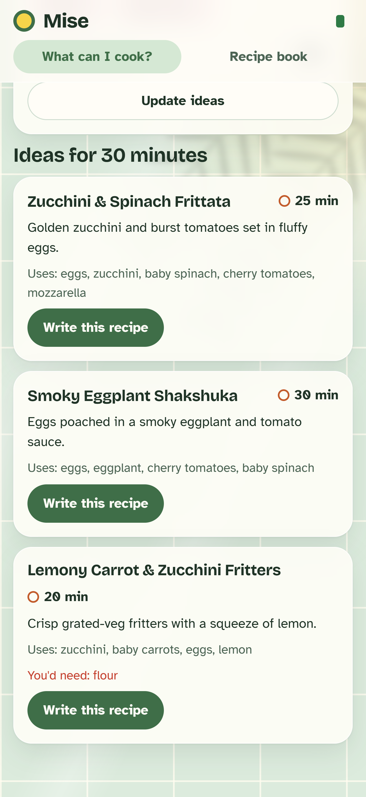
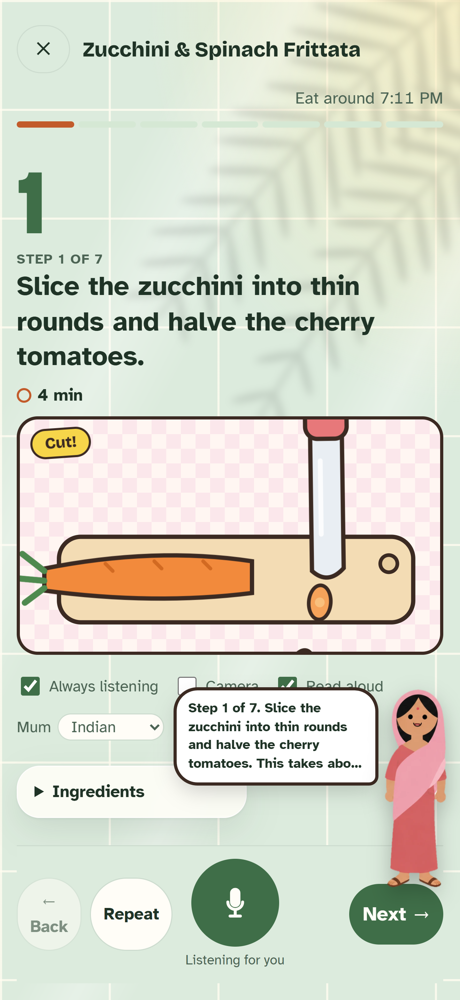
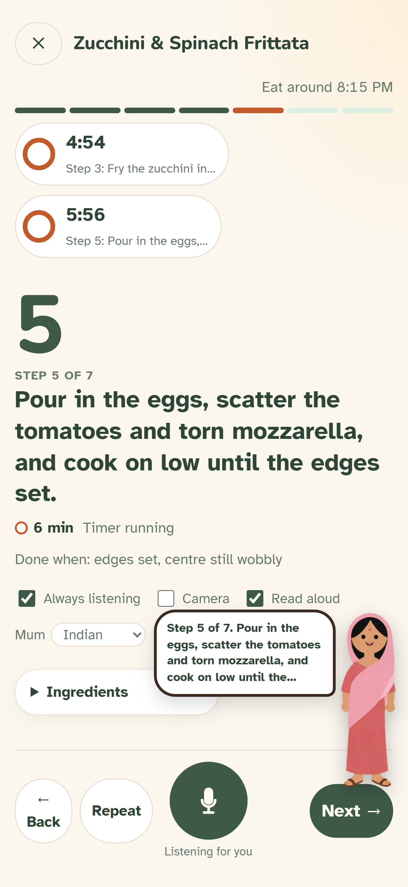
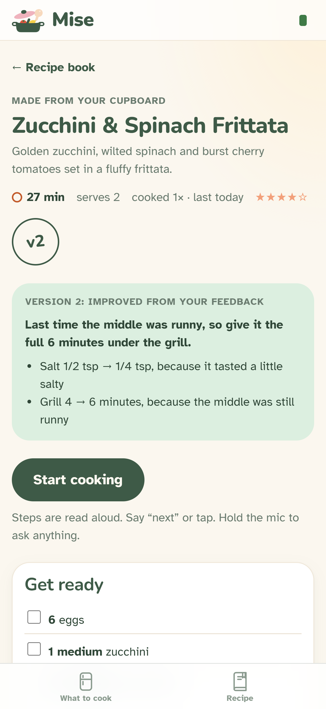

# Mise — the offline sous-chef that gets better every time you cook

**Snap your fridge. Cook hands-free with a voice coach. Tell it how it went, and the recipe gets better.**
Gemma 4 runs on your phone, or on your laptop when you want more power, all through **LiteRT-LM**. Nothing
calls the cloud, and it works with Wi-Fi off.

Built for the **Google Gemma Hardware Hackathon** (AGI House, Oct 24 2026) · tracks: **Mobile AI** and **Best Use of LiteRT**.

▶ **[Watch the 90-second demo](demo/mise_demo.mp4)** · 🌐 **[Try it: mise-gemma.vercel.app](https://mise-gemma.vercel.app)**

| Snap | Choose | Cook with Mum | Ask anything | Version 2 |
|---|---|---|---|---|
|  |  |  |  |  |

### Why it stands out
- **Gemma on the phone itself.** Choose **On this phone**, and Gemma 4 E2B runs on the iPhone: natively on the GPU
  through LiteRT-LM in the Mise iOS app (`ios/`), or on WebGPU in the browser (`web/lib/phone/`). No laptop, no
  internet, nothing leaves the device.
- **Or pair a laptop for more power.** The same app uses the laptop's Intel Arc GPU through LiteRT-LM: Gemma 4 for
  talk, hearing and vision, a second Gemma on the CPU watching the counter, EmbeddingGemma 2 visual memory and a
  Kokoro neural voice. Pairing is one QR scan.
- **One model hears, sees and writes.** Audio and the camera frame go into the same Gemma 4 call. Recipes, ideas
  and revisions are schema-checked JSON, with grammar-constrained decoding (llguidance) as a fallback.
- **Measured, not guessed.** About 1.7 s from a spoken question to the first spoken word (laptop GPU). Word error
  went from 11.9% to 0% on 40 noisy kitchen clips with a transcribe-first pass (`scripts/asr_eval.py`).
- **It learns your kitchen.** Every cook logs real step times and your feedback, and Mise writes a new version
  with the changes explained. The old version stays in the history.

All screenshots are from the iPhone (iPhone 17 Pro Max size), regenerated by `python scripts/demo_screens.py`.

**What Mise does**
1. **Photograph your cupboard** (or fridge), say how long you have (15–90 min) and how many you're feeding.
   Gemma reads the photos into an editable ingredient list and suggests three dishes that fit the time.
2. **Pick one** and Mise writes the full recipe (quantities, timed steps, which steps are hands-off) into your **recipe book**.
3. **Cook hands-free.** Cook mode reads each step aloud, starts timers for hands-off steps, tells you what to prep
   while something simmers, warns a minute before a timer ends, and shows when you'll be eating. Say "next",
   "say that again", "how long is left?", "can I use bacon instead?", or hold up the pan and ask "does this look right?".
4. **Say how it went.** Rating, quick notes ("too salty"), typed or spoken. Mise also records how long each step
   really took. It then writes **version 2** with the changes listed and why. The old version stays in the history,
   and next time you cook it, Mise opens with what changed.

## Get started

Two ways to run Mise:
- **Phone only.** Open https://mise-gemma.vercel.app on the phone, tap the status dot and choose **On this phone**
  (see "No laptop?" below). Or build the iPhone app in `ios/` on a Mac.
- **Phone + laptop, for more power.** The laptop runs the models; the phone (or the laptop's own browser) is the
  camera, microphone and screen. You set it up once (steps 1–4), and after that you just double-click Mise.

### 1. Install Mise on your laptop (once)

**macOS** (Apple Silicon: M1 or later, macOS 12+) or **Linux**:
```bash
git clone https://github.com/neelsirivara/mise-gemma.git && cd mise-gemma
./setup.sh                 # venv + dependencies + ~3 GB of models (Python 3.10–3.13; uses uv if installed)
```
LiteRT-LM runs Gemma on the Mac GPU (Metal). It ships wheels for Apple Silicon only. On an Intel Mac, install
Ollama, run `ollama pull gemma4:e4b`, and start Mise with `./run.sh mise --engine ollama` (slower, and no voice input).

**Windows**:
```powershell
git clone https://github.com/neelsirivara/mise-gemma.git; cd mise-gemma
uv python install 3.12            # or any 3.10–3.13
py -3.12 -m venv .venv
.venv\Scripts\pip install -r requirements.txt
.venv\Scripts\python scripts\download_models.py      # ~3 GB into .\models (--all adds E4B + the Intel NPU build)
```

### 2. Add the Mise icon (once)

- **Windows:** run `powershell -ExecutionPolicy Bypass -File scripts\install_shortcut.ps1`. This puts a **Mise**
  shortcut on your Desktop and in the Start Menu. You can run it again at any time; it replaces the old shortcuts.
- **macOS:** `Mise.command` in the repo folder is your Mise icon. Double-click it in Finder, or drag it to the Dock.
  If macOS says it can't be opened, right-click it and choose **Open** once.

### 3. Start Mise (every day)

Double-click **Mise**. It starts in the background and opens the **Mise Hub** page in your browser at
**http://localhost:8000/hub**. On Windows there is no terminal window. On macOS a small Terminal window appears
while Mise starts; you can close it once the Hub page is open.

The Hub page shows:
- **Status.** It says "Mise is starting" while Gemma loads, then "Mise is ready". The first start takes about a minute.
- **A QR code** to pair a phone.
- **Connected phones**, and when each one was last seen.
- **Open Mise on this laptop**, if you want to cook from the laptop's browser instead (Chrome, Edge or Safari).
- **Quit Mise**, which stops everything. Click it twice to confirm.

If Mise is already running, double-clicking the icon just opens the Hub page again.

The first time, your firewall asks whether Python can accept incoming connections. Allow it, or your phone
can't reach the laptop. On Windows, tick both private and public networks if you plan to use your phone's
hotspot, because Windows often treats a hotspot as public. The first time you use the camera, your browser asks
for camera and microphone access; allow it.

### 4. Pair your phone (once per phone)

1. Put your phone on the same Wi-Fi as the laptop. At a venue, turn on your phone's hotspot and join it from the
   laptop instead, because venue Wi-Fi often blocks devices from reaching each other.
2. Scan the QR code on the Hub page with your phone's camera and tap the link.
3. Follow the steps on the pairing page. It installs a small certificate so your phone trusts the laptop, and it
   moves on by itself when that's done.
4. Tap **Open Mise**, then **Share → Add to Home Screen**.

After that, open Mise from your home screen. Its address is **https://mise.local:8443**, and it stays the same
when the laptop's IP address changes or you move to another network. **PHONE.md** has the full walkthrough,
the reason for the certificate step, and troubleshooting.

### No laptop? Run Gemma on the phone

Tap the status dot and choose **On this phone**. Mise downloads Gemma 4 E2B (about 2 GB) once and then runs it
on the phone: in the browser on WebGPU (`web/lib/phone/`), or natively in the Mise iPhone app (`ios/`, built on a
Mac). The phone keeps its own recipe book. See PHONE.md.

## Architecture

```
 web/mise/ (vanilla JS modules)        apps/mise/ (FastAPI router /api/mise)          core/ (shared engine)
 ──────────────────────────────        ─────────────────────────────────────          ───────────────────────────────
 views: home · pantry · recipe ·  ───▶  routes.py   HTTP API, NDJSON progress streams    llm.py   LiteRT-LM engines
        cook · feedback                 book.py     recipe book: JSON per recipe,                 (GPU talk, CPU watch),
 lib/:  api (hub-aware fetch)                       versions, feedback, cook timings              structured output
        voice (VAD → 16 kHz WAV,        chef.py     scan / ideas / write / revise                 (fast path + grammar
               local TTS)                           (schema-validated JSON)                        fallback)
        camera (preview, snapshots)     cook.py     cook-session state machine:          memory.py EmbeddingGemma 2
                                                    narration, timers, time cues                   visual memory
 hold-to-talk / hands-free ───────────▶ companion.py voice intent router (one structured  phone.py  local HTTPS + QR
                                                    call: next/back/repeat/time/finish/   server.py app hooks, events,
                                                    timer/question/feedback/log)                   timers, static UI
```

* **One model hears and sees.** Gemma 4 takes the WAV and the camera frame in the *same* call, with no separate
  speech-to-text step.
* **Structured output, fast.** Recipes, ideas and revisions are JSON validated against a schema. The fast path
  generates freely with multi-token prediction, then validates; only if that fails does it retry with
  grammar-constrained decoding (llguidance), which is slower per token on Gemma's 262k vocabulary.
  Multi-token prediction is switched off for constrained calls, because its draft tokens bypass the grammar.
* **Voice intents, not free-form tools.** In cook mode every utterance goes through one structured call that picks an
  intent from a fixed list and returns a transcript plus an answer. That's reliable on a 2B model, at 2–6 s per command.
* **Visual memory** (`core/memory.py`). Each watch frame is embedded with multimodal EmbeddingGemma 2,
  so text questions retrieve frames ("did I already salt it?", "where are my keys?").
* **Hub and pairing.** `core/launcher.py` starts the server in the background (phone mode, dual models) and opens
  `web/hub/` on the laptop. `core/phone.py` keeps a local certificate authority in `.certs/`, issues a server
  certificate for `mise.local` and the current IPs on every start, and serves the pairing page on port 8080.
  `core/mdns.py` is a small pure-Python mDNS responder that answers for `mise.local`. Logs go to `data/hub.log`.
* **On-phone engine** (`web/lib/phone/`). The same `/api` routes answered inside the page: the recipe book in
  IndexedDB, the cook session, the intent router and the chef prompts, running Gemma 4 through LiteRT-LM natively
  (the iOS app, via the `window.MiseNative` bridge) or on WebGPU (MediaPipe LLM Inference; the model is cached in
  32 MB resumable pieces).
* **Fallbacks.** Set `-Engine ollama` to use Ollama with `gemma4:e4b` (no audio input there; type instead).
  If the camera fails, upload a photo instead.

## Developer options

You can still run Mise from a terminal. This shows the logs, and phone mode prints the pairing QR code in the
terminal as well as on the Hub page.

| | Windows | macOS / Linux |
|---|---|---|
| Mise | `.\run.cmd mise -Dual` | `./run.sh mise --dual` |
| Phone mode (HTTPS, pairing, Hub page) | `.\run.cmd mise -Dual -Phone` | `./run.sh mise --dual --phone` |
| Ollama fallback | `.\run.cmd mise -Engine ollama` | `./run.sh mise --engine ollama` |

`-Dual` / `--dual` adds a second Gemma 4 E2B on the CPU as the always-on camera watcher. Without phone mode, open
**http://127.0.0.1:8000** in **Chrome, Edge or Safari**. With phone mode, the app is on https://mise.local:8443
(or `https://<laptop-ip>:8443`), the pairing page on `http://<laptop-ip>:8080`, and the laptop gets plain
http://localhost:8000 plus the Hub page at http://localhost:8000/hub. The camera and mic need a real browser,
not an embedded preview.

Smoke test a model/backend: `python scripts/smoke_test.py models/gemma-4-E2B-it.litertlm gpu`

Benchmark the models: `python scripts/bench.py`

## Voice companion
- **Always listening** in cook mode (toggle in the cook screen). Talk over Mise to interrupt it; it stops and listens.
- **Neural voice on the laptop:** Kokoro-82M (Apache-2.0, int8 ONNX, ~120 MB) synthesizes each sentence on the CPU
  and streams it to the phone or browser (`POST /api/tts`). If it's unavailable, the browser's local voice is used.
  Pick a voice with `MISE_VOICE=af_bella` (default), `am_michael`, `af_nicole` or `bf_emma`.
- **Proactive:** a briefing at the start (the longest wait and what to prep during it), chef's tips per step (written
  once per recipe version by Gemma), "while that cooks…" cues, one-minute warnings, a heads-up when an earlier step's
  timer ends, and, with the camera on, "that looks done" check-ins from the watcher model.
- **Smart answers:** questions are answered from the recipe, the current step and the camera frame; short follow-ups
  ("how much of it?") get a focused second pass over the previous exchange.

## Hosting the UI on Vercel
`web/` is a static site (no build step; `web/vercel.json` routes `/` to the Mise app). In Vercel: import the GitHub
repo, set **Root Directory = `web`** and **Framework = Other**. Every push to `main` deploys. The hosted copy is at
https://mise-gemma.vercel.app.

The models still run on the laptop. When you open the hosted page on a paired phone, it looks for the laptop at
https://mise.local:8443 and connects by itself. If it can't find it, it shows a "Can't find Mise on your laptop"
screen with a retry button and an option to enter the address by hand. `?hub=https://<laptop-ip>:8443` in the URL
also works and is remembered. Vercel only serves the page; camera frames, audio and all model calls go
phone ↔ laptop. See PHONE.md.

## Autonomous tests
- `python scripts/mise_api_test.py <url>`: Mise product API with the real model (pantry photo → ideas → recipe →
  cook mode → voice intents → feedback → version 2).
- `python scripts/mise_ui_test.py`: the same flow driven through the Mise UI in real Chrome with a fake camera and
  mic, plus the phone layout. Screenshots go to `assets/ui_test/mise_*.png`.

- `python scripts/phone_mode_test.py`: on-phone mode end to end in Chrome, with a stand-in for the iOS app's
  Gemma bridge (19 checks).
- `python scripts/onboarding_test.py`: the laptop Hub page, the pairing page and `mise.local`.
- `python scripts/asr_eval.py`: word error rate on 40 noisy kitchen clips (`assets/asr/`).
- `python scripts/demo_screens.py` regenerates the iPhone screenshots in `docs/screenshots/`, and
  `python demo/record_film.py` renders `demo/mise_demo.mp4`.

## Repo layout
| Path | What's there |
|---|---|
| `apps/mise/` | Mise on the laptop: recipe book, chef prompts, cook session, voice companion, `/api/mise` routes |
| `core/` | The hub: LiteRT-LM engines, server, launcher, pairing (HTTPS, mDNS, QR), visual memory, Kokoro voice |
| `web/mise/`, `web/lib/` | The app (vanilla JS, no build step); `web/lib/phone/` is the on-phone engine |
| `web/hub/` | The laptop's Hub page |
| `ios/` | The iPhone app: SwiftUI + WKWebView, Gemma 4 through LiteRT-LM on the GPU |
| `scripts/` | Setup, model download, tests and benchmarks; `scripts/dev/` has deploy and monitoring helpers |
| `docs/screenshots/`, `demo/` | iPhone screenshots and the demo film |

## Env knobs (`core/config.py`)
`APP`, `GEMMA_ENGINE` (litert|ollama), `GEMMA_TALK_MODEL`, `GEMMA_TALK_BACKEND` (cpu|gpu|npu),
`GEMMA_WATCH_MODEL`, `GEMMA_WATCH_BACKEND`, `GEMMA_MAX_TOKENS`, `PORT`, `PHONE`, `SETUP_PORT`, `LOCAL_PORT`.

## License
Apache-2.0 (the hackathon requires open source). Gemma models are under the Gemma / Apache-2.0 terms on their model cards.
Fridge photos in `assets/demo/photos/` are CC0, from Wikimedia Commons.
